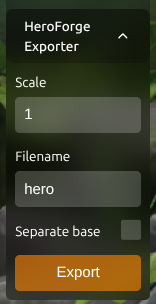

# HeroForge Exporter

A simple tool to export models from [HeroForge](https://www.heroforge.com/) as STL files for 3D printing or GLB files for use in 3D applications.

STL is intended for 3D printing. GLB carries the current posed geometry, UV coordinates, available material colors, and readable image textures in a single file. Open GLB directly in Blender; Unity projects may need a glTF importer package. Export quality and texture availability depend on the data exposed by the current HeroForge page, so GLB may not exactly match the website preview.

## How to use

1. Open [HeroForge](https://www.heroforge.com/) in your web browser.
2. Open the browser's developer console (usually F12 or right-click and select "Inspect").
3. Copy the following code and paste it into the console:

```javascript
(() => {
  const script = document.createElement('script');
  script.src = 'https://cdn.jsdelivr.net/gh/marianocordoba/heroforge-exporter@main/dist/hfe.js';
  document.head.appendChild(script);
})();
```

4. Press Enter to execute the code.
5. A widget will appear in the bottom-left corner of the screen. Choose STL for printing or GLB for Blender/Unity, then export.



## Disclaimer

- This tool is not affiliated with or endorsed by HeroForge. Please respect HeroForge's terms of service and intellectual property rights.

- The exporter code was written by Claude Opus 4.5 so I don't really know how it works.

- Pasting the code into the console is done at your own risk. Review the code before executing it.
